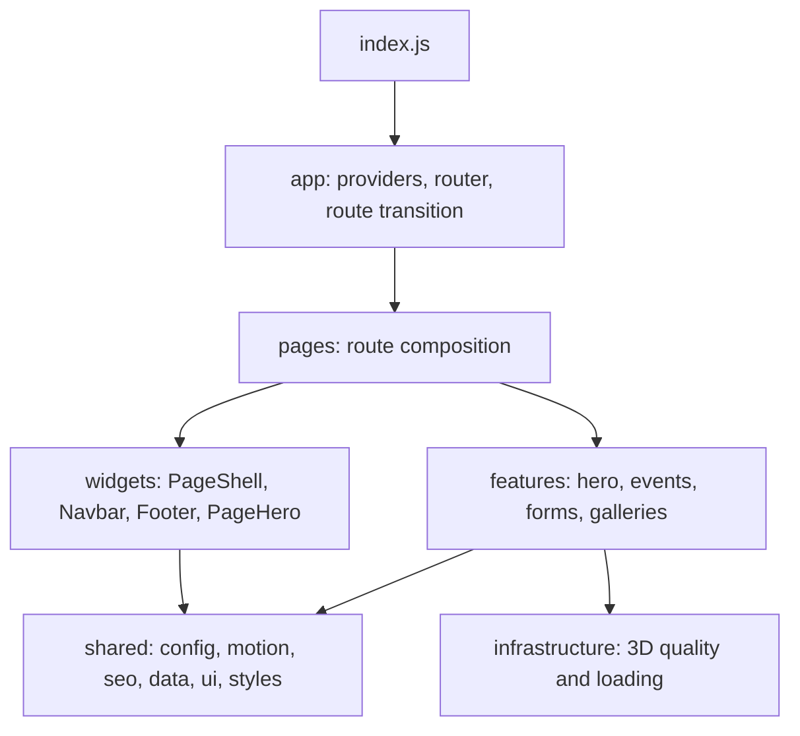

# Genesis Hacks website

The site at [www.genesishacks.com](https://www.genesishacks.com). Genesis connects companies with India's student hackathon and builder community, curates brand partnerships with independent hackathons, and runs its own series, Hackers Occupied. The next event is **Hackers Occupied Delhi 2027**.

Built with React 19, Framer Motion, Lenis, Three.js (the hero mascot) and Tailwind, bundled with Create React App + CRACO, and deployed on Vercel with serverless functions in `api/`.

## Project structure



| Where | What lives there |
|---|---|
| `frontend/src/shared/config/site.js` | **Single source of truth for public facts**: contact email and phone, reply time, attendee and event counts, Hackers Occupied Delhi and Pune details, proof-point events. Change a fact here, never in a page. |
| `frontend/src/shared/config/routes.json` | Title, description and H1 for every public route. Read by the app (`useSeo`) and by the build-time prerender, which also builds `sitemap.xml` from it. |
| `frontend/src/shared/data/events.js` | The curated event archive, with the role Genesis played at each event (Organiser or Event Partner). Ships with the build; nothing is cached in the visitor's browser. |
| `frontend/src/shared/motion/` | Shared animation primitives (split-text reveals, scramble text, magnetic hover, velocity marquee, pixel route transition). All respect reduced motion. |
| `frontend/src/widgets/layout/PageShell.jsx` | Chrome for every route: header, cursor, smooth scroll, per-route SEO tags, footer. |
| `frontend/scripts/prerender.mjs` | Runs after the build and writes static HTML for each route (see below). |
| `api/` | Vercel functions: `submit-form` (all forms), `contact` (legacy alias), `certificate` (Pune certificates). |
| `supabase/migrations/` | Database schema for form submissions. |

## Routing, SEO and 404s

`npm run build` runs `craco build` with source maps off, then `node scripts/prerender.mjs`. The prerender writes one HTML file per route in `routes.json`, plus every organiser-guide article:

- `/` → `build/index.html`, `/about` → `build/about.html`, `/events/hackers-occupied-delhi` → `build/events/hackers-occupied-delhi.html`
- each file has its own `<title>`, description, canonical URL, Open Graph tags and real text inside `#root`, so crawlers, link previews and AI agents that skip JavaScript still see content. The Hackers Occupied pages also carry Event JSON-LD. The home page shell carries Organization and WebSite JSON-LD.
- `build/404.html` (noindex) is served by Vercel with a real **404 status** for any unknown URL. The app still boots there and shows its Not Found page.
- `build/sitemap.xml` and `build/llms.txt` are generated from the same data.

`vercel.json` uses `cleanUrls` (so `about.html` is served at `/about`) and has **no catch-all rewrite**, which is what used to turn every URL into a 200. Old and alternate URLs (`/sponsors`, `/partners`, `/certificate`, `/event-membership`, `/hackers-occupied-pune`, `/admin-events`) are permanent redirects.

**Adding a route:** add it to `AppRouter.jsx` *and* to `routes.json`. A route missing from `routes.json` is not prerendered and gets a 404 status on a direct visit.

## Forms and Supabase

Every form (contact, partner, collaborate, join the crew, Hackers Occupied Delhi interest) posts JSON to `/api/submit-form`. The function:

1. validates the form type, email format and field lengths, and silently drops bots that fill the hidden `company_website_confirm` field;
2. rate-limits to 5 submissions per IP per 10 minutes (the IP is stored only as a salted hash);
3. uploads a partner deck (PDF or PowerPoint, up to 3 MB) to the private `partner-decks` storage bucket;
4. inserts a row into `public.form_submissions`;
5. also forwards the submission to the Google Sheets webhook when `GOOGLE_SHEETS_WEBHOOK_URL` is set;
6. optionally emails the team through Resend.

It answers `200 { ok: true, id }` only when Supabase or the Sheets webhook accepted the submission, `503 no_provider` when neither is configured, and `502 store_failed` when both failed. Validation errors are `400` with a code (`invalid_email`, `unknown_form`, `attachment_too_large`, ...), rate limits are `429 too_many_submissions`.

### Environment variables

Set these wherever the site is hosted (on Vercel: Project Settings → Environment Variables). `.env.example` lists the names.

| Name | Required | Purpose |
|---|---|---|
| `SUPABASE_URL` | yes | Supabase project URL (Supabase → Project Settings → API). |
| `SUPABASE_SERVICE_ROLE_KEY` | yes | Server-only key. Never expose it to the browser or prefix it with `REACT_APP_`. |
| `FORM_IP_SALT` | recommended | Random string used to hash visitor IPs for rate limiting. |
| `GOOGLE_SHEETS_WEBHOOK_URL` | optional | Apps Script web app URL, if you still want a copy in Google Sheets. See [`docs/GOOGLE_SHEETS_SCRIPT.md`](docs/GOOGLE_SHEETS_SCRIPT.md). |
| `RESEND_API_KEY` | optional | Sends the team an email for each new submission. |
| `CONTACT_TO_EMAIL` | optional | Where those emails go. Defaults to `partner@genesishacks.com`. |
| `CONTACT_FROM_EMAIL` | optional | Verified sender for Resend, for example `Genesis Hacks <forms@genesishacks.com>`. |

### Apply the database migration

The schema is one plain SQL file: `supabase/migrations/20261013120000_form_submissions.sql` (table, indexes, per-form views, retention function and the private `partner-decks` bucket). No CLI needed:

1. Supabase dashboard → **SQL Editor** → **New query**.
2. Drag the file in (or paste its contents) and click **Run**. It is safe to run again.
3. Copy the project URL and the `service_role` key from **Project Settings → API** into `SUPABASE_URL` and `SUPABASE_SERVICE_ROLE_KEY`, then redeploy.

`supabase/README.md` has a one-minute check that everything is in place.

### Reading submissions

Open the Supabase dashboard → **Table Editor**. Each form has a readable view:

- `partner_inquiries`: sponsors and partners (with goals, budget band, timeline and the deck path)
- `contact_messages`
- `collaboration_requests`
- `crew_applications`
- `delhi_interest_signups`

Use the `status` (`new`, `in_progress`, `replied`, `closed`, `spam`) and `notes` columns on `form_submissions` to track follow-up. Decks are in **Storage → partner-decks**.

## Start locally

```bash
cd frontend
npm install
npm start          # app only, at http://localhost:3000
```

The `/api` functions do not run under `npm start`. To test forms end to end, use a preview deployment, or run the functions locally (`vercel dev` from the repository root, with the variables from `.env.example` in `.env.local`).

## Commands

```bash
npm start                 # development server (frontend/)
npm test                  # test runner
npm run build             # production build + prerender
npm run prerender         # re-run the prerender on an existing build
npm run optimize:models   # generate adaptive GLB tiers
npm run optimize:models:ktx2
```

## Security follow-ups

The October 2026 audit found an admin login with a hard-coded password in the public JavaScript. The route and every import of it are gone from the build, and `/admin-events` now redirects home. Still to do by hand:

- [ ] Change the old admin password anywhere else it was reused.
- [ ] Delete the unused files `frontend/src/pages/admin/` and `frontend/src/shared/services/adminAuthService.js` (no longer imported or bundled).
- [ ] In Google Search Console, request removal of `/admin-events`, then submit `https://www.genesishacks.com/sitemap.xml`.
- [ ] Restrict sharing on the attendee Google Sheets whose links used to sit in the event data. They remain in git history, so treat those links as public.
- [ ] Confirm the facts marked `NEEDS_CONFIRMATION` in `site.js`, `events.js` and the legal pages (legal entity, address, Grievance Officer, retention periods).

## Documentation

Start with [`docs/README.md`](docs/README.md). It links to architecture, contribution workflow, code standards, performance rules, and UI/animation/3D practices.
